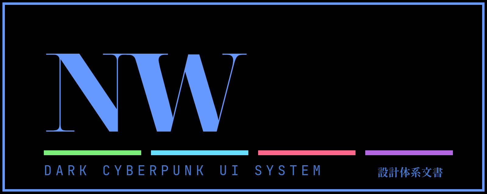

<div align="center">



# Nightwire

**A dark-mode-only cyberpunk UI design system.**
Framework-agnostic. Pure `#000000` void. Semantic neon palette. AI-first.

</div>

Built on top of [nerv-ui](https://github.com/TheGreatGildo/nerv-ui) by [TheGreatGildo](https://github.com/TheGreatGildo).

## Design Principles

1. **Pure black void** — Background is always `#000000`. No gray, no navy.
2. **Neutral first, color = function** — Text, labels and edges are neutral. Color appears where it means something: data, state, focus, the selected item. Don't use color decoratively.
3. **Readable first** — 14px base font, 1.5 line-height. Legibility over density.
4. **No CRT effects, no decorative glow** — No scanlines, no flicker, no vignette. Glow is a state signal only (LED, check, switch, progress) and is off in `archive`.
5. **Soft neon** — Cyberpunk-inspired but not eye-burning. Vibrant, not harsh.
6. **Square and quiet** — Square corners, 1px hairlines, one solid bone-colored action per view; every other button is an outline, except `.btn-danger` and `.btn-chrome`.

### What v3 looks like

v3 replaces the v2.1.0 look in every component and every intensity: neutral labels and hairlines, square corners, a bone `.btn` with outline secondaries, a neutral default `.tag`, and glow that never decorates. Blue stays on focus rings and accent lines, green on data. The four typefaces, the kanji labels and the three intensities are unchanged. [`docs/design/v3/direction.md`](docs/design/v3/direction.md) records every value and the reason for it.

v3 is a major release and removes the v1 compatibility surfaces that v2 kept: `.led.green|blue|red|yellow` (use `.led[data-state="ok|active|error|warn"]`), `.tag-warning` (`.tag-warn`), `.nw-progress .fill` (`.nw-progress-fill`), `.stack` (`.nw-stack`) and the `--nw-header-gradient` and `--nw-header-pattern` tokens. [`docs/design/v3/v1-inventory.md`](docs/design/v3/v1-inventory.md) lists each one; the migration guide, `docs/migration/v3.md`, is written later in this release.

## Installation

### CLI Installer (Recommended)

```bash
npx @cativo23/nightwire install
```

Interactive prompts detect your project type (Next.js, Vite, Astro, plain HTML) and copy the right files:
- `nightwire.css` — **35 pure CSS component stylesheets**, 130 design tokens (primitives, semantic roles, motion, intensity knobs)
- `DESIGN.md` — AI-readable design spec (Google design.md standard)
- `skill/nightwire/SKILL.md` — AI skill for Claude, Cursor, Copilot, v0

### Manual Installation

```bash
npm i @cativo23/nightwire
```

Then import `@cativo23/nightwire/nightwire.css` and, for Tailwind,
`@cativo23/nightwire/tailwind.preset.js`. Without npm, copy `nightwire.css` and
`tailwind.preset.js` from the repository root. In a project without `"type": "module"`, save the
preset as `.mjs`, as the installer does, to avoid the `MODULE_TYPELESS_PACKAGE_JSON` warning.

## Quick Start

### Vanilla CSS
```html
<link rel="stylesheet" href="nightwire.css">
```

### Tailwind CSS
```js
// tailwind.config.js
import nightwirePreset from '@cativo23/nightwire/tailwind.preset.js';
export default { presets: [nightwirePreset] };
```

The package is an ES module. In a CommonJS config, take the default export:
`presets: [require('@cativo23/nightwire/tailwind.preset.js').default]`. A bare `require(...)`
returns the module namespace, and Tailwind drops it without an error: no `nw-*` utility is
generated. The installer copies the preset as `nightwire.tailwind.preset.mjs`; import that file when
you use it.

### Fonts
```html
<link href="https://fonts.googleapis.com/css2?family=Noto+Serif+Display:wght@700;800;900&family=JetBrains+Mono:wght@400;500;700&family=Saira+Extra+Condensed:wght@400;600;700;800&family=Shippori+Mincho+B1:wght@500;700;800&display=swap" rel="stylesheet">
```

### AI Agents (Claude Code, etc.)
Drop `SKILL.md` into your project as a skill. The agent can then generate Nightwire-compliant UIs from natural language prompts.

## What's Included

**Design tokens** — Colors, semantic roles, surfaces, type scale, spacing, border radius.

**Utility classes** — Text color, glow effects, surface levels, borders, grid layouts.

**Component styles** — Buttons, cards, panels, modals, drawers, command palette, tabs, sidebar nav, dropdowns, breadcrumbs, tooltips, data tables, metrics grids, stats, badges, tags, status LEDs, avatars, key-value rows, form controls, progress bars, steps, skeleton loaders, toasts, dividers.

**Tailwind preset** — All tokens mapped to Tailwind's config (colors, fonts, spacing, radius, shadows, motion). Colour, glow and motion utilities reference the CSS custom properties, so they follow `data-intensity` and runtime overrides, and opacity modifiers such as `bg-nw-cyan/40` keep working.

**Accessibility** — Text pairings pass WCAG AA on the black surfaces and control boundaries keep 3:1 (`npm run design:contrast` checks every pairing). Focus-visible outlines. Reduced-motion support.

### Browser support

The baseline is the latest 2 versions of Chrome, Edge, Firefox and Safari. They get the full open
and close animations on drawer, modal, command palette, dropdown, toast and tooltip. Other
browsers still open and close every component correctly, without the animation. Chrome and
Firefox are tested; Safari is supported by declaration and has not been tested.

### Reduced motion

`prefers-reduced-motion: reduce` wins at every intensity, `archive` and `combat` included. It sets
`--nw-motion-scale` to `0`, pauses the LED pulse and the loops (`--nw-pulse-state` and
`--nw-loop-state`), and switches off every transition and animation, pseudo-elements included.
`.uplink` content shows at its end state and the button press shift is removed. Overlays still
open and close, instantly.

## Color Palette

| Role | Color | Hex | Contrast on Black |
|---|---|---|---|
| Primary | Blue | `#6699ff` | 7.5:1 |
| Success | Green | `#7aed7a` | 11.2:1 |
| Info | Cyan | `#66ddff` | 10.8:1 |
| Danger | Red/Pink | `#ff6688` | 6.4:1 |
| Warning | Yellow | `#e8993a` | — |
| Accent | Purple | `#b266e0` | — |

## File Structure

```
nightwire/
├── nightwire.css                      <- The stylesheet (generated from src/, committed)
├── tailwind.preset.js                 <- Tailwind CSS preset (generated from tokens, committed)
├── DESIGN.md                          <- AI-readable design spec (token sections generated)
├── src/
│   ├── tokens/tokens.json             <- Every design token, W3C DTCG format (the only token source)
│   ├── index.css                      <- Ordered manifest: the cascade order
│   ├── base/                          <- Reset, accessibility, typography
│   ├── utilities/                     <- Surface, text, glow, border, layout classes
│   └── components/                    <- One file per component
├── cli/                               <- `nightwire install` CLI source (TypeScript)
├── skill/nightwire/
│   ├── SKILL.md                       <- AI skill (full design system spec)
│   └── references/                    <- Examples & layout docs
├── examples/html/                     <- Full demos, workshop and component snippets (all load nightwire.css)
├── apps/docs/                         <- Docs site (React + Vite + Tailwind)
├── docs/                              <- Architecture notes, proposals, roadmap
├── scripts/                           <- Build scripts and the parity tool
└── tests/                             <- Unit tests (node:test)
```

`nightwire.css`, `tailwind.preset.js` and the paths above stay where consumers expect them. To
work on Nightwire itself, see [CONTRIBUTING.md](CONTRIBUTING.md).

## What v2 added, still here in v3

See [`examples/html/workshop.html`](examples/html/workshop.html) for a live tour.

- Layer 2 semantic tokens (`--nw-chrome`, `--nw-data`, `--nw-signal-*`, `--nw-ai`) and the role tokens `--nw-action`, `--nw-action-hot` and `--nw-action-text` behind the bone `.btn`
- **Intensity system** via `<html data-intensity="archive|operator|combat">` — one attribute reconfigures glow, motion, density, kanji visibility, padding. Operator is the default
- Components: command palette (`.cmdk`), drawer, form suite (`.field`/`.switch`/`.check`/`.combo`), code/diff/steps, button & tag variants, layout primitives
- Motion vocabulary: `--nw-tick`, `--nw-sweep` and `--nw-uplink` (enter), their `-out` composites
  (exit), `-duration` and `-ease` longhands for both directions, `--nw-stagger`, and the loop
  tokens `--nw-loop-spin`, `--nw-loop-shimmer` and `--nw-loop-state`. Everything scales with
  `--nw-motion-scale`; loop cycles scale inversely. Plus the `prefers-reduced-motion` contract
  above
- Overlays take `data-open`: drawer, modal and command palette are closed unless `"true"`;
  dropdown and toast are open unless `"false"`; a tooltip opens on hover and focus unless
  `"false"`. An overlay added to the page already open does not animate in: mount it with
  `data-open="false"` and set `"true"` two animation frames later. See [DESIGN.md](DESIGN.md)

See `CHANGELOG.md` for the full list of changes.

## Credits

Built on [nerv-ui](https://github.com/TheGreatGildo/nerv-ui) by TheGreatGildo. Licensed under MIT.
